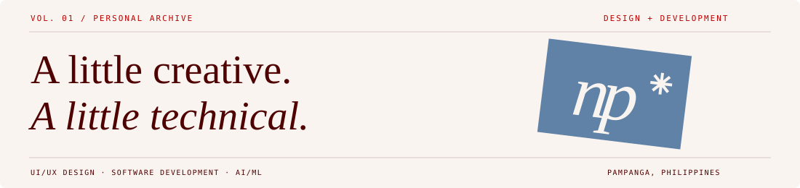

# np✳ / Niña Pascua

**Live site:** Add your live site link here.



My little corner of the web: a collection of projects, things I've learned, and ideas I've brought to life through design and code.


## Features

| Inside the archive | What you'll find |
| --- | --- |
| Selected work | Six projects, category filters, case studies, and screenshot galleries |
| The person | A little about me, my education, leadership, and awards |
| The toolkit | Skills, technologies, and certification verification links |
| Say hello | Contact details, social links, and a viewable/downloadable CV |

The small details matter too: responsive layouts, keyboard navigation, gentle entrance and scroll animations, and a transparent favicon that adapts to dark mode. Animations respect reduced-motion preferences.

## Tech stack

**React 19** · **JavaScript** · **CSS** · **Vite 8**

Static site, no backend or environment variables to configure.

## Getting started

You'll need **Node.js 22.12+** and **npm**. Clone or download this repository, then open a terminal in the project folder:

```sh
npm ci
npm run dev
```

Open the URL printed in the terminal, normally `http://127.0.0.1:5173`. Stop the server with `Ctrl+C`.

On Windows PowerShell, use `npm.cmd` if `npm` is blocked by the execution policy.

## Available scripts

| Command | Purpose |
| --- | --- |
| `npm run dev` | Start the local development server |
| `npm test` | Check content, assets, and page rendering |
| `npm run build` | Create the production site in `dist/` |
| `npm run preview` | Preview the production build locally |

## Project structure

```text
public/
  assets/               Photos, screenshots, badges, and CV
  favicon.svg           Adaptive favicon
src/
  components/           Page sections and shared components
  App.jsx               Page layout, navigation, and dialogs
  data.js               Portfolio content
  main.jsx              React entry point
  styles.css            Styles and responsive layouts
  useScrollReveal.js    Scroll reveal behavior
  utils.js              Asset URL helper
docs/                   README artwork
tests/                  Content, asset, and rendering checks
index.html              Page metadata and favicon link
vite.config.js          Development and build configuration
```

## Updating the portfolio

- Edit `src/data.js` to update projects, skills, credentials, leadership, and profile asset paths.
- Edit `src/components/PageSections.jsx` for the introduction, biography, education, and contact details.
- Add images and the CV to `public/assets/`; reference them using paths relative to `public/`.
- Adjust colors, typography, and animations in `src/styles.css`.
- Update the title and description in `index.html`, and the live site link at the top of this README.

Run `npm test` after content changes to check required assets, credential data, page rendering, and internal anchors.

## Deployment

```sh
npm run build
npm run preview
```

Deploy to a static host with these settings:

| Setting | Value |
| --- | --- |
| Install command | `npm ci` |
| Build command | `npm run build` |
| Publish directory | `dist` |

The build uses relative asset paths to support subdirectory hosting. Make source changes outside `dist/`, since each build regenerates that directory.

## Author

Made by **Niña Pascua** · [GitHub](https://github.com/ninapascua)

*Always learning. Always making.*
